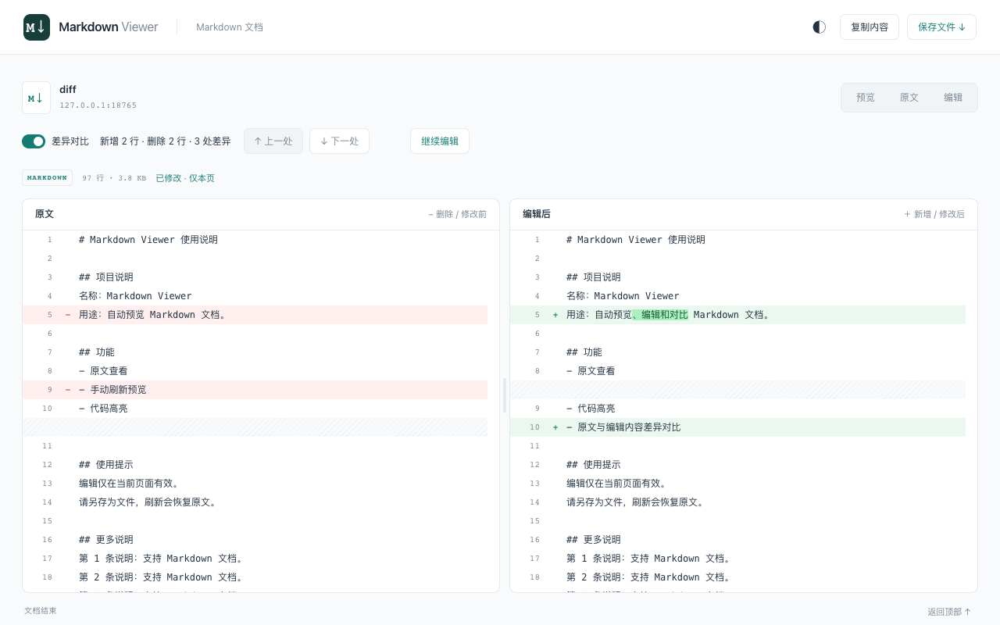

  
  <h1>Markdown Viewer</h1>
  
<strong>让浏览器里的 Markdown，打开就好读。</strong>

  
自动预览接口与文件 · 代码高亮 · 临时编辑 · 原文差异对比

  

    
    
    
  

  

    <a href="https://github.com/erjin-zhi/markdown-viewer/releases/latest">下载安装包</a> ·
    <a href="#功能亮点">功能亮点</a> ·
    <a href="PRIVACY.md">隐私政策</a> ·
    <a href="https://github.com/erjin-zhi/markdown-viewer/issues">反馈建议</a>
  

  

## 功能亮点

| 功能 | 体验 |
| --- | --- |
| **打开即预览** | 像 JSON Viewer 一样，直接打开 Markdown 接口或文件即可阅读，无需复制粘贴。 |
| **清晰排版** | 代码语法高亮、目录导航、表格、任务列表、引用与折叠内容。 |
| **随手编辑** | 原文随时可查；临时修改后查看预览，一键保存为 `.md` 文件。 |
| **真正的 diff** | 左侧原文、右侧编辑后内容；增删行和行内修改高亮，同步滚动、逐处跳转。 |
| **舒服地阅读** | 深浅主题、响应式布局，窄窗口也能看；代码与正文都可复制。 |
| **本地处理** | 正文和编辑内容不上传，不接入统计服务，文档图片由你决定是否加载。 |

## 看清每一处修改

编辑后开启「差异对比」：**红色是删除，绿色是新增，更深的底色标出行内变化**。两边按行对齐，支持拖动分栏和上一处／下一处导航。

  

**修改仅在当前页面有效。** 切换视图不会丢失编辑内容；刷新后恢复原文。保存会下载当前编辑内容，不会写回接口或覆盖源文件。

🌙 深色模式

 

  

## 安装与使用

目前通过 [GitHub Releases](https://github.com/erjin-zhi/markdown-viewer/releases/latest) 下载；Chrome 应用商店版本尚未上架。

1. 下载并解压最新的 `Markdown-Viewer-v*.zip`。
2. 打开 Chrome 的 `chrome://extensions`，开启「开发者模式」，点击「加载已解压的扩展程序」，选择解压后的文件夹。
3. 直接打开 Markdown 文件或接口，开始阅读。

需要 **Chrome 128+**。预览本地 `.md` 文件时，请在扩展详情中开启「允许访问文件网址」。

## 支持范围

自动识别 Markdown 响应类型及 `.md`、`.markdown` 等文件路径；无法确定的纯文本，可从扩展菜单手动预览。支持常用 GitHub 风格 Markdown，数学公式与 Mermaid 图表暂不渲染。

扩展处理直接打开的文档，不接管网页内部的 API 请求、JSON 中的 Markdown 字段或普通 HTML 页面。超长文档会保留原始文本；差异计算超出限制时会明确提示。

## 隐私与开源

解析、高亮、编辑和 diff 都在本机进行。仅保存主题与开关设置，以及当前浏览器会话所需的页面地址和响应类型；不保存正文或编辑草稿。详情见 [隐私政策](PRIVACY.md)。

采用 [ISC License](LICENSE)。欢迎通过 [Issues](https://github.com/erjin-zhi/markdown-viewer/issues) 提交建议或问题。
